  🇺🇸 <b>English</b> · 🇧🇷 <a href="https://github.com/V1n1c1u5P4iva/V1n1c1u5P4iva/blob/main/README.pt-BR.md">Português</a>

  <h1>👋 Hello, I'm Vinicius!</h1>
  
Computer Science student passionate about software development and building scalable back-end systems.

  

---

## 🚀 About Me

- 💻 **Computer Science Student**: Since 2023, I've been immersed in the world of programming, diving into technologies and honing my skills.
- 📚 **Lifelong Learner**: Constantly expanding my knowledge with modern tools, frameworks, and development practices.
- 🎯 **Career Focus**: Back-end development — creating reliable, efficient systems that deliver real value.

---

## 🛠️ Technologies

  
  
  
  
  
  

---

## 📚 Frameworks & Libraries

  
  
  
  
  

---

## 🌐 My Social Profiles

  

---

  
💡 <em>"Code is like poetry; it's all about expressing complex ideas with elegance and precision."</em>

