  🇺🇸 <a href="https://github.com/V1n1c1u5P4iva">English</a> · 🇧🇷 <b>Português</b>

  <h1>👋 Olá, eu sou o Vinicius!</h1>
  
Estudante de Ciência da Computação apaixonado por desenvolvimento de software e pela construção de sistemas back-end escaláveis.

  

---

## 🚀 Sobre Mim

- 💻 **Estudante de Ciência da Computação**: Desde 2023 estou imerso no mundo da programação, explorando tecnologias e aprimorando minhas habilidades.
- 📚 **Aprendizado Contínuo**: Sempre expandindo meu conhecimento com ferramentas, frameworks e boas práticas modernas de desenvolvimento.
- 🎯 **Foco de Carreira**: Desenvolvimento back-end — criando sistemas confiáveis e eficientes que entregam valor real.

---

## 🛠️ Tecnologias

  
  
  
  
  
  

---

## 📚 Frameworks & Bibliotecas

  
  
  
  
  

---

## 🌐 Minhas Redes

  

---

  
💡 <em>"Código é como poesia; trata-se de expressar ideias complexas com elegância e precisão."</em>

